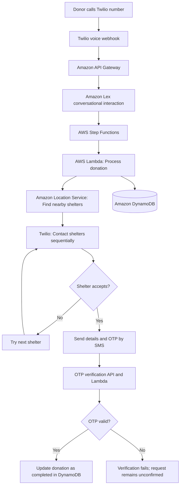

# Food Redistribution System

A **voice-enabled, AWS serverless food redistribution platform** that connects people and organizations with surplus food to nearby shelters that can accept donations. Donors can initiate a request through a simple phone call, without needing to install a mobile app or use a web portal.

> **Project type:** Proof of Concept (POC)

## Problem Statement

Surplus food from events and gatherings is often discarded because donors cannot quickly find and coordinate with nearby shelters. Manual searching and calling can delay donations while food is still suitable for consumption.

## Solution Overview

The system uses conversational voice interaction, geospatial shelter discovery, and automated communication to coordinate donations. It collects the food type, quantity, and ZIP code from the donor, searches for nearby shelters, contacts them sequentially until one accepts, and verifies the donation using an OTP.

## Key Features

- **Phone-based donation requests:** Donors can start the process through a phone call instead of needing a mobile or web application.
- **Conversational data collection:** Amazon Lex helps capture donation details, including food type, quantity, and ZIP code.
- **Location-based shelter matching:** Amazon Location Service identifies nearby shelters and supports expanding the search radius when no suitable shelter is found initially.
- **Automated shelter outreach:** The system calls shelters in sequence and proceeds to the next shelter if a request is declined.
- **OTP-based confirmation:** The donor and accepting shelter receive details and an OTP to verify the donation.
- **Centralized tracking:** Amazon DynamoDB stores donation requests, shelter information, and donation status.
- **Serverless workflow:** AWS Lambda and AWS Step Functions coordinate the backend processing without requiring a continuously running application server.

## End-to-End Workflow

1. A donor calls the configured Twilio phone number.
2. The voice interaction collects the food quantity, ZIP code, and food type.
3. The request is sent through Amazon API Gateway and starts the AWS Step Functions workflow.
4. AWS Lambda processes the request and uses Amazon Location Service to identify nearby shelters.
5. Twilio contacts the identified shelters sequentially and asks each shelter to accept or decline.
6. If a shelter declines, the workflow tries the next suitable shelter.
7. When a shelter accepts, the donor and shelter receive each other’s relevant details and an OTP through SMS.
8. The OTP is verified through the API and backend workflow.
9. After successful verification, the donation status is marked as completed and recorded in DynamoDB.

## Architecture

## Technology Stack

| Area | Technologies / Services |
|---|---|
| Cloud platform | Amazon Web Services (AWS) |
| Voice calls and SMS | Twilio Programmable Voice and SMS |
| Conversational interface | Amazon Lex |
| API and webhook entry point | Amazon API Gateway |
| Backend processing | AWS Lambda (Python) |
| Workflow orchestration | AWS Step Functions |
| Geospatial search | Amazon Location Service |
| Data storage | Amazon DynamoDB |
| OTP verification interface | Basic HTML page connected to backend APIs |

## Prerequisites

To configure and test this proof of concept, you will need:

- An AWS account with appropriate permissions to configure the required services.
- A Twilio account and a configured phone number with voice and SMS capabilities.
- An Amazon Lex bot configured for the donation conversation.
- The required Lambda functions, Step Functions state machine, API Gateway endpoints, Amazon Location Service resources, and DynamoDB tables.
- A web host for the basic OTP verification page, if used separately from the backend.

## Configuration

The implementation requires configuration for Twilio, AWS resources, the OTP expiry duration, and the default shelter search radius. The exact variable names and resource identifiers should match the application code and AWS setup.

Typical configuration values include:

| Setting | Purpose |
|---|---|
| Twilio Account SID | Identifies the Twilio account |
| Twilio Auth Token | Authenticates requests to Twilio |
| Twilio phone number | Number used for inbound and outbound calls and SMS |
| AWS Region | Region containing the configured AWS resources |
| Resource identifiers / ARNs | References for Lambda functions, Step Functions, API Gateway, and other resources used by the application |
| DynamoDB table names | Tables for donation requests and shelter records |
| OTP expiry duration | Determines how long an OTP remains valid |
| Default search radius | Initial distance used to search for nearby shelters |

**Security:** Do not commit Twilio credentials, OTP secrets, or other sensitive configuration values to GitHub. Supply them through an appropriate secure configuration mechanism and grant AWS services only the permissions they need.

## Deployment and Setup Outline

The deployment depends on the AWS resources and configuration used by your implementation. At a high level:

1. Create or configure the DynamoDB tables for donation requests and shelter details.
2. Configure the Amazon Location Service resources used for geospatial shelter search.
3. Deploy the Lambda functions for donation processing, shelter search, and OTP generation/verification.
4. Configure the Amazon Lex bot and its intents/slots to collect the required donation information.
5. Create the Step Functions state machine to orchestrate processing, sequential shelter outreach, and confirmation.
6. Configure API Gateway endpoints for Twilio webhooks and OTP verification.
7. Configure the Twilio phone number to call the appropriate webhook and enable outbound calls and SMS.
8. Configure the required environment variables, resource identifiers, and IAM permissions.
9. Host and configure the basic OTP verification page, if required by the implementation.
10. Test the workflow using sample shelter records and a test donation request.

> This README describes the project's architecture and setup flow. Exact commands, endpoint paths, environment-variable names, and AWS resource names depend on the code and infrastructure configuration in the repository.

## Testing the Workflow

1. Call the configured Twilio number.
2. Enter the food quantity and ZIP code when prompted, and provide the food type through the voice interaction.
3. Confirm that the workflow processes the request and searches for nearby shelters.
4. Test both shelter responses: acceptance and rejection. On rejection, the system should try the next shelter.
5. For an accepted request, verify that the donor and shelter receive the relevant details and OTP.
6. Submit the OTP through the verification flow and confirm that the donation status is updated in DynamoDB after successful verification.

Use test phone numbers and sample shelter data during development. Actual calls and messages may incur charges through AWS or Twilio.

## Current Limitations

- Shelter records are preconfigured for the proof of concept and may not reflect real-time shelter availability.
- The system does not currently provide real-time food pickup or delivery tracking.
- Sequential outreach can take longer when multiple shelters decline a request.
- Voice recognition and call handling may be affected by unclear input or call/network interruptions.
- Error handling and some edge cases are limited in this POC.

## Possible Future Enhancements

- Build dedicated web and mobile interfaces for donors and shelters.
- Add multilingual voice interaction.
- Integrate real-time shelter availability and NGO/shelter management systems.
- Add pickup and delivery tracking and logistics integrations.
- Introduce priority-based matching using urgency, food type, and shelter capacity.
- Add monitoring, analytics, stronger error handling, load testing, and CI/CD automation for production readiness.

## Social Impact

The project demonstrates how voice interaction, geospatial search, and cloud workflow automation can help reduce coordination delays between surplus-food donors and shelters. By making the donation process accessible through a phone call, it aims to improve the chances of redistributing usable food to communities in need.

## Project Status

This repository represents a **proof of concept**. Production deployment would require verified shelter data, comprehensive testing, stronger operational monitoring, and additional security and reliability hardening.
